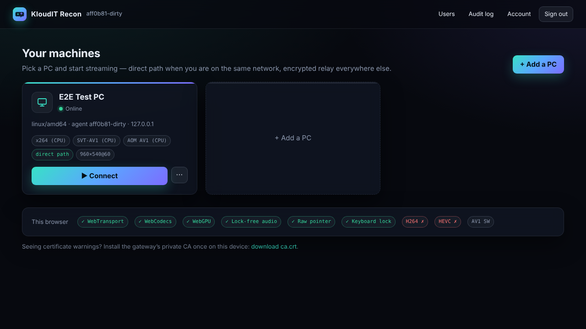
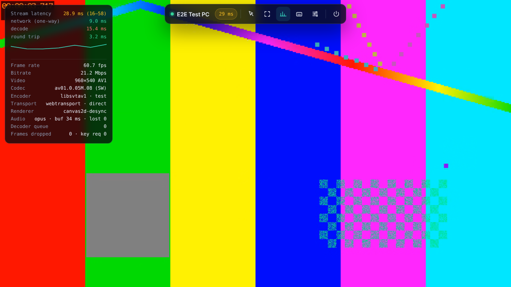

# KloudIT Recon

**Browser-native, ultra-low-latency remote play for your Windows gaming PC.**
No client app: open a tab on any device, sign in, and play. A tiny gateway on your
Proxmox server handles auth, Wake-on-LAN and relaying. A lightweight agent on the
PC captures the screen on the GPU, hardware-encodes it, and injects your input.



Think *Apache Guacamole, rebuilt for games*. Guacamole remotes desktops over
RDP/VNC; Recon streams a GPU-encoded game feed straight into the browser's
hardware decoder and sends input back over QUIC.

---

## What makes it different

| | Recon | Steam Remote Play / PS Remote Play | Parsec | Moonlight + Sunshine | Guacamole |
|---|---|---|---|---|---|
| Client | **any modern browser** | app | app | app | browser |
| Transport | **WebTransport / HTTP-3 QUIC**, WebSocket fallback | proprietary UDP | proprietary UDP | RTSP + ENet | WebSocket (TCP) |
| Video decode | **WebCodecs, hardware**, no media-element buffering | native | native | native | images / canvas |
| Self-hosted gateway with users, 2FA, audit | **yes** | no | no | no | yes |

---

## Features

**Status.** Everything below is built and tested in CI and in a GPU-less sandbox: unit and
integration tests, a browser end-to-end test with software encoders, and Wine for the Windows
code. Nothing GPU-specific has run on a real AMD or NVIDIA GPU yet. The first sessions on real
hardware follow **[docs/HARDWARE_TEST_PLAN.md](docs/HARDWARE_TEST_PLAN.md)**, and
[docs/VENDOR_NOTES.md](docs/VENDOR_NOTES.md) records what has been verified where.

### Video on the PC

- **Native encoder helper.** `recon-encoder.exe` (C++) is the default on AMD and NVIDIA.
  - DXGI Desktop Duplication hands D3D11 textures to AMF or NVENC in the same process, and each
    encoded frame reaches the agent through shared memory. AMD Direct Capture and
    Windows.Graphics.Capture are available on request.
  - Bitrate and frame-rate changes happen inside the running encoder.
  - A lost frame is answered with a recovery frame from frames the browser acknowledged (AMF
    long-term references, NVENC reference invalidation) instead of a key frame.
  - Intel Quick Sync runs through the helper's libavcodec backend (`-InstallLibavcodec`).
- **FFmpeg as the fallback.** `ddagrab` or `gfxcapture` feed NVENC, AMF or QSV. The agent reads
  FFmpeg's NUT container, which hands over each packet the moment it is encoded (MP4/MKV hold
  each frame until the next one exists). On a PC or VM without a GPU it captures with GDI
  (`gdigrab`) instead and encodes on the CPU (see "Running on a PC or VM without a GPU").
- **Tuned for latency.**
  - CBR, or AMF's latency-constrained VBR.
  - A 1-3-frame VBV, no B-frames and no lookahead.
  - GPU scheduling priority, so a game at 100 % GPU does not queue the encoder behind it.
- **Codec Auto.**
  - HEVC first, on AMD and NVIDIA alike.
  - AV1 or H.264 where the browser decodes them clearly faster, from a decoder self-test timed
    while connecting.
  - AV1 on RDNA3 only at sizes in 64×16 steps.
- **`recon-host qualify`** measures, once per GPU and driver, which bitrate changes the encoder
  makes without a glitch, and sessions use the result.
- **Changes without a freeze.** A change of resolution, codec or display starts a new encoder
  while the old one keeps streaming, then switches on the new key frame.
- **Virtual display (opt-in).** A virtual monitor at the client's resolution and frame rate,
  through the Virtual Display Driver or Apollo's SudoVDA. The PC's layout comes back after the
  stream.
- **HDR10 end to end** (experimental, opt-in). 10-bit BT.2020 PQ HEVC or AV1 with HDR metadata,
  shown on an extended-range WebGPU canvas.
- **Under load and on still pictures.**
  - Temporal SVC thinning: under congestion the frames no other frame references are left out,
    with no damage and no key frame.
  - The frame rate goes down before the picture does at the bitrate floor.
  - The bitrate drops on a static desktop.
  - Regions of interest spend more bits around the pointer or a game's crosshair.
  - Experiments, off by default: a dedicated encode engine, re-encoding oversized frames (NVENC)
    and slice output (AMF).

### Network

- **One QUIC stream per video frame (WebTransport).** A lost packet delays only its own frame.
  WebSocket is the fallback.
- **Direct path on the LAN.** WebTransport straight to the PC, with certificate-hash pinning
  and a single-use, origin-bound gateway ticket. The PC listens on each of its addresses (LAN,
  IPv6, Tailscale, ...) and the browser tries them all at once, the one on its own network
  first. With Network path *Auto* over WebTransport, a session that had to start on a relay
  moves to the direct path by itself when it answers, without a restart. Without it:
  1. The gateway's **UDP relay**, which forwards the datagrams of the same end-to-end QUIC
     connection.
  2. A QUIC splice on the gateway's main port.
  3. WebSocket.
- **Rate control.** The host's QUIC congestion control (`media`) paces the video at 1.2 × its
  bitrate. A delay-based rate controller (GCC / SCReAM style) reads the browser's receive
  reports every 25 ms:
  - It lowers the bitrate as soon as a queue builds, and climbs back once the delay is down.
  - At the 2 Mbit/s floor it lowers the frame rate instead: 120 → 100 → 90 → 75 → 60 on the
    helper.
- **Loss-recovery ladder.**
  1. A frame stream stalled past its deadline is cancelled.
  2. A recovery frame repairs the picture.
  3. A key frame is the last rung.
  4. RESET_STREAM_AT is used where the browser negotiates it.
- **Send priorities.** Input and audio go first. When the path falls behind, the host keeps at
  most one video frame in flight beyond those in transit, so audio, cursor and clock datagrams
  never wait behind a video backlog.
- **Datagram + FEC video.** On paths with a minimum round trip above 15 ms, frames travel as
  datagram shards with Reed-Solomon parity and NACKs, instead of one stream per frame.

### Browser client

- **The media pipeline runs in a Worker.** WebTransport → reorder buffer → `VideoDecoder`
  (`optimizeForLatency`, at most 2 chunks queued) → OffscreenCanvas. A self-test catches
  decoders that hold frames back, and a hardware decoder that keeps failing falls back to
  software.
- **Renderers.** A desynchronized 2D canvas, WebGL2, or WebGPU `importExternalTexture`. *Auto*
  measures them on the live stream once per browser.
- **Frame pacing.** *Lowest latency* draws each frame as it decodes. *Smooth* draws one per
  display refresh.
- **FSR 1 upscaling** (WebGPU), for a stream shown larger than it is sent.
- **Live latency readout.** NTP-style clock sync and per-frame host timestamps split *capture →
  on screen* into its stages (p50/p95/p99). A latency probe reads a frame barcode and exports a
  capture → drawn histogram. The other direction too: the PC acknowledges inputs, so the
  overlay shows *Input → host* (your mouse, key and controller events until the PC injected
  them) and the PC's log records it.
- **Browser check.** The dashboard and the stream page say when your browser is older than the
  Chromium this client is tested with (141) and lacks something it uses, and what updating
  brings; in orange, with "for lower latency", only where what it lacks costs latency by
  itself (WebTransport, raw mouse events).

### Input and audio

- **Raw mouse.** `pointerrawupdate` and Pointer Lock with `unadjustedMovement`. Motion travels as
  running totals in datagrams, so a lost datagram delays motion but never drops it. Every event
  goes out at once: no batching, no timers; telemetry gives way to it.
- **Keyboard.** Scancodes through SendInput. In fullscreen, Keyboard Lock passes Esc, Alt+Tab
  and Win to the PC.
- **Cursor.** The PC's real cursor shapes are drawn locally.
- **Controllers.** Virtual Xbox controllers through ViGEmBus, at 250 Hz, with rumble back to
  your controller.
- **Audio.** WASAPI loopback → Opus (CELT low-delay, pure Go). 10 ms frames, 5 ms on a LAN when
  the capture allows it. A SharedArrayBuffer ring and an AudioWorklet whose jitter buffer adapts
  between 10 and 60 ms.

### Gateway and security

- **A small gateway on Proxmox** (LXC or Docker). It handles users (Argon2id passwords, TOTP
  2FA), rate limiting and lockout, an audit log and Wake-on-LAN.
- **A private CA** that, on a new install, can vouch only for the gateway's own names and
  private addresses, and rotating WebTransport certificates.
- **The PC dials out.** Its tunnel pins the gateway's identity, so the PC opens no inbound port
  except the optional direct path on Private networks.
- **The elevated agent** runs FFmpeg and its libraries only from folders that only
  administrators control. See [docs/SECURITY.md](docs/SECURITY.md).

### Defaults

What a fresh install does without any setting. The browser's settings drawer (Ctrl+Alt+Shift+O)
and the PC's `host.json` (Configuration below) change them.

| | Default |
|---|---|
| Video pipeline | the native helper on AMD and NVIDIA, FFmpeg otherwise and as the fallback (`pipeline` `auto`) |
| Capture | Desktop Duplication (`capture` `auto`); GDI on a PC or VM without a GPU |
| Codec | Auto: HEVC first (`av1` `fallback`) |
| Bitrate, frame rate, resolution | 30 Mbit/s, 60 fps, *Native* (caps: `maxKbps` 250000, `maxFps` 240) |
| Encoder preset, adaptive bitrate | Balanced, on |
| Congestion control, FEC | `media`, `auto` (datagrams + FEC above 15 ms of minimum round trip) |
| Thinning, static desktop, regions of interest | `svc`, `staticBitrate` and `roi` all `auto` |
| Network path | Auto: direct → UDP relay → QUIC splice → WebSocket |
| Renderer, frame pacing, upscaling | Auto, Lowest latency, Auto (FSR 1 with Renderer WebGPU) |
| Decoder, audio | Prefer hardware; Opus with the Auto jitter buffer |
| Mouse, cursor | Desktop mode, local cursor |
| HDR | off on the PC (`hdr` `off`), Auto in the browser |
| Virtual display | off (`install-host.ps1 -InstallVirtualDisplay` sets `auto`) |
| GPU priority | `auto`: realtime, or high on NVIDIA with hardware-accelerated GPU scheduling |
| Ports | direct path UDP 48100; gateway TCP+UDP 8443, relay UDP 8444-8459 |
| Experimental, off | AMD Direct Capture (`capture` `amf`), `encoderInstance`, `reencodeOversized`, `sliceOutput` |

### Documentation

| Document | What it covers |
|---|---|
| [docs/INSTALL.md](docs/INSTALL.md) | Installing, step by step: gateway, PC, first stream, remote access, upgrading, uninstalling |
| [docs/HARDWARE_TEST_PLAN.md](docs/HARDWARE_TEST_PLAN.md) | The first sessions on real hardware: an ordered plan (AMD first, then NVIDIA), with the acceptance tests T1-T10 and what to send back |
| [docs/ARCHITECTURE.md](docs/ARCHITECTURE.md) | Protocol, latency design, rate control, loss recovery, send priorities, FEC, HDR10 |
| [docs/SECURITY.md](docs/SECURITY.md) | Security model and known limitations |
| [docs/HELPER_PROTOCOL.md](docs/HELPER_PROTOCOL.md) | The native encoder helper: protocol, backends, MSVC build, live-bitrate qualification |
| [docs/VENDOR_NOTES.md](docs/VENDOR_NOTES.md) | What has been verified where, per GPU vendor, with every hardware check in full |
| [docs/NETEM.md](docs/NETEM.md) | Network test profiles (lan, wifi, wan, capdrop) |
| [docs/LATENCY_RIG.md](docs/LATENCY_RIG.md) | The click-to-photon latency rig |
| [third_party/README.md](third_party/README.md) | Vendored and ported code (quic-go patch, FSR 1) |



## Measured results

The browser end-to-end test (`test/e2e/browser.mjs`) runs the real gateway, the real host agent
and headless Chromium, and checks video, audio, input delivery and latency on every path. These
numbers come from CI-like conditions: **software** SVT-AV1 encoding and **software** AV1 decoding,
both competing for the same 4-core VM, 960×540 at 60 fps:

| Path | Encoder-out → on screen | Network (one-way) | Decode (software AV1) | FPS | Click → first frame |
|---|---|---|---|---|---|
| WebTransport, direct to PC | **17–27 ms** (typ. 20) | 6–10 ms | 8–13 ms | 60 | ~300 ms |
| WebTransport via gateway | **24–36 ms** (typ. 26) | 9–13 ms | 10–18 ms | 60 | ~300 ms |
| WebSocket via gateway | **19–46 ms** (typ. 23) | 6–10 ms | 10–30 ms | 60 | ~300 ms |

These are ranges across repeated runs. Decode time dominates the spread because the software decoder
competes with the software encoder for the same CPU.

These numbers are a worst case. On your PC, NVENC/AMF/QSV encode in a few milliseconds and the
browser decodes in hardware, with no CPU contention. The overlay shows your live numbers
(**Ctrl+Alt+Shift+S**).

---

## Architecture

```
 Browser (Chrome / Edge / Firefox / Safari 26.4+)
   main thread: UI, raw input, gamepads, AudioWorklet
   worker:      WebTransport ─► reorder ─► VideoDecoder ─► OffscreenCanvas (2D / WebGL2 / WebGPU)
        │   HTTPS (UI, API)            TCP 8443
        │   UDP relay (WebTransport)   UDP 8444-8459 ── relay path, one port per session
        │   HTTP/3 WebTransport        UDP 8443  ── relay fallback (QUIC splice)
        │   WebSocket (fallback)       TCP 8443
        │
        │                ┌─────────────────────────────────────────────┐
        ├───────────────►│ recon-gateway  (Proxmox LXC, ~20 MB RAM)    │
        │                │ auth · 2FA · users · audit · Wake-on-LAN    │
        │                │ private CA · rotating WebTransport certs    │
        │                │ UDP relay (datagram forwarder, TURN-like)   │
        │                │ cut-through splice (QUIC↔QUIC, WS↔QUIC)     │
        │                └──────────────▲──────────────────────────────┘
        │                               │ QUIC tunnel, host dials out,
        │                               │ gateway identity pinned (SPKI);
        │                               │ UDP relay socket, also outbound
        │   direct path (LAN):          │
        │   WebTransport UDP 48100      │
        │   cert-hash pinned, ticket    │
        ▼                               │
 ┌──────────────────────────────────────┴───────────────────────────┐
 │ recon-host  (Windows 11 gaming PC)                               │
 │ recon-encoder.exe: DDA ─(D3D11)─► AMF/NVENC ─► shared mem ─► Go  │
 │ or ffmpeg: ddagrab/gfxcapture ─► NVENC/AMF/QSV ─► NUT ─► Go      │
 │ (no GPU: gdigrab, GDI ─► libx264 on the CPU)                     │
 │ WASAPI loopback ─► Opus (pure Go) ─► datagrams                   │
 │ SendInput (scancodes, raw rel/abs mouse) · cursor shapes · ViGEm │
 └──────────────────────────────────────────────────────────────────┘
```

Protocol and latency details: [docs/ARCHITECTURE.md](docs/ARCHITECTURE.md).
Security model: [docs/SECURITY.md](docs/SECURITY.md).
Test network profiles (lan, wifi, wan, capdrop): [docs/NETEM.md](docs/NETEM.md).

---

## Quick start

The full walkthrough, with every command, what success looks like and what to do when a step
fails, is in **[docs/INSTALL.md](docs/INSTALL.md)**. The short version:

### 0. Get the binaries

Every push builds release bundles in GitHub Actions. Sign in to GitHub, open **Actions → ci →**
the newest green run **→ Artifacts → `kloudit-recon-binaries`** (not `e2e-results`). The zip
contains:

- `kloudit-recon-<version>-gateway-linux-amd64.tar.gz`: the gateway and its install scripts
  (Proxmox nodes are amd64; the `-arm64` tarball is for ARM boards)
- `kloudit-recon-<version>-host-windows-amd64.zip`: the PC agent and its PowerShell installer
- `SHA256SUMS`

To build them yourself (needs Go 1.26+, `zip`; mingw-w64 and cmake for the optional
`recon-encoder.exe` helper): `make release`. The output goes to `dist/`. The CI bundles differ
in one way: their `recon-encoder.exe` is the MSVC build (`make release
HELPER_EXE=path/to/recon-encoder.exe`, built with the MSVC steps in `docs/HELPER_PROTOCOL.md`),
while a plain `make release` packages the mingw-w64 build, which has no Windows.Graphics.Capture
(mingw-w64 lacks C++/WinRT). With it, window capture and `"capture": "gfxcapture"` sessions
stream with FFmpeg instead of the helper (host.log: `video pipeline pipeline=ffmpeg
reason="the helper cannot capture with wgc (this build has no C++/WinRT headers ...)"`).

### 1. Gateway on Proxmox (LXC)

Copy the gateway tarball to the Proxmox node **without extracting it on Windows** (that loses
the execute bits), for example from PowerShell on your PC:
`scp (Get-Item .\kloudit-recon-*-gateway-linux-amd64.tar.gz).Name root@<proxmox-ip>:/root/`.
Then, in the node's shell (web UI → your node → **>_ Shell**):

```bash
cd /root && tar xzf kloudit-recon-*-gateway-linux-amd64.tar.gz && cd gateway-linux-amd64
./create-lxc.sh --ctid 210 --ip 192.168.1.50/24,gw=192.168.1.1   # a free LAN address; or --ip dhcp
```

This creates a small unprivileged Debian 12 container (1 core, 512 MB) with the gateway
running as a hardened systemd service. It prints the URL and a **one-time setup token**.
Use a static IP (or a DHCP reservation): paired PCs remember the gateway's address.
Other options: `--storage`, `--bridge`, `--port`, `--name`; upgrade later with
`./create-lxc.sh --upgrade 210` from a newer bundle (settings are kept).

Other ways to install:
- **Existing LXC/VM** (Debian/Ubuntu): `sudo ./install-gateway.sh --binary ./recon-gateway`
- **Docker** (builds from source): `git clone https://github.com/karamkamal1/KloudIT-Recon.git &&
  cd KloudIT-Recon && docker compose -f deploy/docker/docker-compose.yml up -d --build` (host
  networking, so Wake-on-LAN broadcasts reach your LAN). The setup token is in
  `docker compose -f deploy/docker/docker-compose.yml logs`.

### 2. First login

Open `https://<gateway-ip>:8443` (with `https://`). The gateway uses its own private CA: accept
the warning once, or download **ca.crt** from the dashboard and install it as a trusted root on
your devices (it can vouch only for the gateway's own names and private addresses, not for
other websites). Enter the setup token (it stays valid until used; it's also in
`/var/lib/kloudit-recon/setup-token.txt`, e.g. `pct exec 210 -- cat /var/lib/kloudit-recon/setup-token.txt`),
create your admin account, then enable 2FA under **Account**.

### 3. Add your gaming PC

Open the dashboard **from the gaming PC** using the gateway's LAN IP (the pairing code
remembers the address you browse with). Click **+ Add a PC**, give it a name, click
**Create pairing code**, then click **Copy**. Then, signed in to Windows as the user who plays, open **PowerShell as
administrator**, `cd` into the unzipped `host-windows-amd64` folder and paste the copied command:

```powershell
powershell -ExecutionPolicy Bypass -File .\install-host.ps1 -PairingCode "recon1:..." -InstallViGEm
```

The installer:
- downloads FFmpeg (an FFmpeg 8.1+ release build from BtbN's GitHub releases, checked against
  the SHA-256 that release publishes; `-FFmpegPath` uses an `ffmpeg.exe` you choose instead)
- pairs the agent with your gateway
- registers a hidden **logon task** with highest privileges, so input reaches elevated games;
  it starts the agent again when the agent crashes (`host.log`: `agent exited, starting it again`)
- opens UDP 48100 for the direct path on Private networks only (it warns if your network is
  set to Public)
- installs ViGEmBus for controller support (`-InstallViGEm`)
- optionally installs the Virtual Display Driver (`-InstallVirtualDisplay`: pinned release,
  SHA-256 verified; with Apollo's SudoVDA already there it installs nothing) and sets
  `"virtualDisplay": "auto"` in `host.json`: a stream the PC's monitor cannot show 1:1 (another
  size, which with the default resolution *Native* is the browser's screen, or a higher frame
  rate) then gets a virtual monitor at the client's resolution and frame rate, the primary
  display while it runs (see `virtualDisplay` below); the device stays disabled (no extra
  monitor) between streams
- optionally downloads FFmpeg's LGPL shared libraries (`-InstallLibavcodec`: BtbN's FFmpeg 8.1
  LGPL shared build, checked like FFmpeg) into `ffmpeg-lgpl\` for the native encoder helper's
  Intel Quick Sync backend; the GPL `ffmpeg.exe` stays the FFmpeg command-line path
- starts the agent and checks that it reaches the gateway, and warns if no GPU encoder works

The PC's card in the dashboard shows **Online** when the agent connects.

### 4. Play

Click **Connect**, then **Start streaming**. Click into the picture, press
**Ctrl+Alt+Shift+F** for fullscreen with keyboard lock, and **Ctrl+Alt+Shift+M** for game
(raw mouse) mode. Chrome or Edge give the best experience (keyboard lock, WebTransport).

---

## Using it

| Shortcut (Ctrl+Alt+Shift + …) | Action |
|---|---|
| **M** | Toggle mouse mode: *Desktop* (absolute pointer, local cursor) ↔ *Game* (pointer lock, raw relative input) |
| **F** | Fullscreen + Keyboard Lock (Esc / Alt+Tab / Win go to the PC; hold Esc to leave) |
| **S** | Performance overlay (latency breakdown, fps, bitrate, codec, path) |
| **O** | Settings drawer (it takes the keyboard focus: Tab moves through it, Esc closes it); also on the start screen, which has a Settings button too |
| **V** | Type text on the PC (paste passwords, chat) |
| **Q** | Disconnect |

**Settings** (applied live unless noted):
- **Codec**: Auto prefers hardware encode on the PC *and* hardware decode in your browser, and
  there HEVC (then AV1, then H.264), on AMD and NVIDIA PCs alike. While connecting, the browser
  times each codec's decoder on a short 1080p clip (overlay: "Decoder self-test … timed 1080p");
  a codec your browser decodes clearly faster replaces HEVC (H.264 only when it saves a lot, as
  it needs more bitrate for the same picture; AV1 only on PCs with `"av1": "faster"`). AV1 is
  available only where the PC's GPU encodes it (AMD RDNA3 and newer, NVIDIA RTX 40 and newer);
  RDNA3 uses it only at sizes in 64×16 steps (e.g. not 1920×1080).
- **Bitrate**: 50–150 Mbps on a LAN. Over the internet, stay below your upload speed.
- **Frame rate** (up to 240) and **resolution** (*Native*: the PC display's own size, or this
  screen's where the PC streams a virtual display, `virtualDisplay` below; other sizes are
  downscaled on the GPU, or get a virtual display of that size). The PC streams at most its
  display's refresh rate, so for the lowest latency pick that rate or more (on a 75 Hz
  display: 90, which streams 75): a frame rate below the display's leaves out some of its
  frames (one in five at 60 on 75 Hz), and the stream looks less smooth than the PC. The
  native helper sends most of the others the moment the PC shows them when they come
  regularly; a game on the display's refresh that misses some refreshes (vsync at a frame
  rate below the display's) still waits, about 4 ms typically and up to ~14 ms, for its
  turn; before the second hardware run every frame waited, up to a whole frame
  (docs/VENDOR_NOTES.md "Second hardware run: in-game capture and encoder latency").
- **Encoder preset**: lowest latency / balanced / best quality.
- **Display**: pick a monitor on multi-monitor PCs.
- **Audio**: Opus or lossless PCM, plus the jitter buffer: *Auto* (default, adapts within
  10–60 ms) or *Fixed* at the size you set.
- **Network path, transport, renderer and decoder**: these apply on reconnect. Network path
  *Direct to PC only* has no fallback: where the PC cannot be reached directly every connection
  fails, and the start screen then offers **Use Network path Auto** and **Settings**. The
  drawer's **Reset to defaults** puts every setting back.
- **Renderer** *Auto* (default) tries the 2D canvas, WebGL2 and WebGPU on the live stream for
  about 10 s, on the first connection in a browser once the stream runs at its frame rate (on a
  still desktop it waits up to a minute for something to move: start the game first), and
  remembers its pick for that browser version. A context that reports low-latency
  (desynchronized) presentation comes before one that cannot say, which comes before one
  without it; among those it leaves the 2D canvas only for a path that draws clearly faster.
  It measures again by itself when the stored pick came from
  an earlier version of the page (the first hardware run's), from a stream too short of frames
  to compare the paths (once a later connection has a steady stream), from another display
  refresh rate, or is over 30 days old. The overlay shows the numbers, and *Measure renderers
  again* repeats it. This is a heuristic:
  pick a renderer yourself after measuring with the latency rig
  ([docs/LATENCY_RIG.md](docs/LATENCY_RIG.md)).
- **Upscaling** (applies at once): *Auto* (default) upscales with FSR 1 when the picture is shown
  more than 5 % larger than it streams and the renderer is WebGPU; otherwise it scales
  bilinearly. *FSR 1* upscales whenever the picture is enlarged, and *Off* never does.
  *FSR sharpness* runs from 0 (sharpest) to 2 stops (default 0.2). Renderer *Auto* keeps
  Chrome's desynchronized 2D canvas, so **choose Renderer *WebGPU* for FSR**.
- **HDR** (experimental): *Auto* (default) streams HDR10 when everything allows it:
  - the PC's `"hdr": "auto"`, with the PC's display in Windows HDR mode;
  - this display in HDR mode;
  - Renderer *WebGPU* (Chrome / Edge 131+);
  - a 10-bit HEVC or AV1 decoder whose frames the browser can copy.

  *Off* streams SDR, and tone-maps (ITU-R BT.2390) an HDR stream already running. *HDR: SDR
  white* (default 203 cd/m²) sets how bright the desktop is shown. The overlay's *HDR* rows say
  why a stream is not HDR.
- **Frame pacing**: *Lowest latency* (default) draws each frame the moment it decodes. *Smooth*
  draws at most one new frame per display refresh, for an even cadence, at a cost of up to one
  refresh of latency (the overlay's *hold* row).
- **Latency probe** (Diagnostics): open `tools/latency-test/index.html` (in the release zip:
  `latency-test\index.html`) full-screen on the streamed monitor of the PC; the overlay then shows
  host screen → drawn latency measured from the picture, and **Export latency data** saves it.

The stream pauses automatically when the tab is hidden, which frees your PC's GPU. While you
watch, the PC's display stays on (also with only a controller's input); while the tab is hidden
the power plan's display timeout applies again.

## Playing away from home

The best option is **Tailscale or WireGuard** to your home network. QUIC/UDP passes through
untouched, so you keep WebTransport and the direct path. Other options:

- **Port forwarding**: forward **TCP and UDP 8443** and **UDP 8444–8459** (the relay ports,
  `-relay-ports`) to the gateway, with the same port numbers. The account is protected by
  Argon2id, 2FA, rate limiting and lockout. Set `RECON_NAMES` to your domain and preferably use
  a real certificate (`-cert`/`-key`).
- **HTTP-only reverse proxies / tunnels** (e.g. Cloudflare Tunnel) carry only TCP. Recon
  detects this and falls back to WebSocket automatically. Pass the proxy's address with
  `-trust-proxy` so rate limiting sees real client IPs: on the LXC install
  `RECON_TRUST_PROXY=127.0.0.1` in `/etc/kloudit-recon/gateway.env` for a `cloudflared` running
  next to the gateway (or `install-gateway.sh --trust-proxy 127.0.0.1`), in Docker the same
  variable under `environment:`. Without it every login arrives from the proxy's address: all
  clients share one rate limit, and anyone can lock an account out for everyone by failing its
  password.
- **A reverse proxy for HTTPS only** (Nginx Proxy Manager, Caddy, Traefik on TCP 443/8443) with
  UDP forwarded to the gateway: pass the proxy's address with `-trust-proxy` (on the LXC install
  `RECON_TRUST_PROXY=<proxy IP>/32` in `/etc/kloudit-recon/gateway.env`), or the UDP relay
  never works. The relay accepts a browser only from the IP its HTTPS request came from, and
  without `-trust-proxy` that IP is the proxy's.

## Running on a PC or VM without a GPU

Recon streams from a PC or virtual machine without a graphics card (a Proxmox VM with the default
display, Windows showing only the *Microsoft Basic Display Adapter*; also VirtIO-GPU, QXL, the
Standard VGA, Hyper-V's or VMware's display adapter), but not as well as from a gaming PC:

- **What happens.** Windows has no Direct3D 11 video device there, so neither GPU capture
  (Desktop Duplication, Windows.Graphics.Capture) nor a GPU encoder works. The agent finds this
  when it starts, before any stream (it opens the device itself, as FFmpeg would), and captures
  with GDI (`gdigrab`) and encodes on the CPU (`libx264`); it does not start the native encoder
  helper where Windows lists no GPU. `recon-host probe` and the installer say `capture:
  ddagrab unavailable (no Direct3D 11 video device: a PC or VM without a GPU, or a graphics driver
  being installed or reset): using gdigrab`; the browser shows `No GPU screen capture on this PC
  (...): capturing with GDI, which uses more CPU and adds latency.` once per stream, as
  information (a plain toast, without the yellow or red border of a warning or an error).
- **What it costs, and the CPU budget.** GDI copies the whole picture into memory on the CPU
  every frame interval, changed or not (at the monitor's size, whatever size streams), and the
  CPU converts and encodes it. A small VM (2-4 vCPUs) does not keep up with 1920×1080 at 60 fps,
  and a CPU that does not keep up adds hundreds of milliseconds (frames wait in FFmpeg's queues:
  on two CPUs, 1080p at 60 fps delivered 23-27 fps with 350-380 ms from grab to encoded, 1080p
  at 30 fps with the fastest preset 27-28 fps with 64-68 ms). So the agent measures what the CPU
  encodes and how fast GDI grabs the screen when it starts, and again while nothing streams
  (`software encoding measured` in host.log; the best measurement counts), and streams at what
  the CPU keeps up with: the fastest preset first, then 45 or 30 fps, then 1600×900, 1280×720 or
  960×540, then 20 fps; the stream itself moves it down when frames fall behind and tries a step
  up when the CPU has room. The overlay's *CPU limit* row says what it streams and what was asked
  for (`1920×1080 at 30 fps, fastest preset (asked: 1920×1080 at 60 fps): what the CPU keeps up
  with`), and an informational notice says it once. `"cpuBudget": "off"` streams what the client
  asks for regardless. Give the VM more cores for more (the frame rate rises with them), and in
  Proxmox set the VM's CPU type to `host` (Hardware > Processors > Type): the default
  (`x86-64-v2-AES`) hides AVX2 from Windows, and libx264 and FFmpeg's conversion are much slower
  without it (compare `recon-host report`'s `cpu:` line before and after). The settings drawer's
  Resolution and Frame rate still cap the stream. Changing the VM's display resolution while you
  stream is fine: the stream follows it within a second or two.
- **Remote desktop, the console and the lock screen.** The agent captures the desktop of the
  Windows session it runs in. When a remote desktop (RDP) client closed and left that session
  disconnected (no display at all), the agent moves the session to the console while a stream
  plays (not while its browser tab is hidden) and once it has found it disconnected two seconds in
  a row, as `tscon <session> /dest:console` does, unless someone else is signed in there. The
  console then shows the session **unlocked**: on a VM that is the hypervisor's console (Proxmox:
  the VM's *Console*, which only Proxmox's users see), on a physical PC its own monitor. So by
  default (`"consoleSession": "auto"`) it does this only on a virtual machine (Windows' firmware
  names a hypervisor: QEMU/Proxmox, Hyper-V, VMware, VirtualBox, Xen) or a PC without a GPU;
  `"on"` does it on any PC, `"off"` never (the notice then says how to do it by hand; host.log
  logs each move as a warning, and `recon-host report` says whether a move would happen). While
  an RDP client is connected the stream shows the RDP session's desktop (with GDI). A locked
  session, the sign-in screen or a UAC prompt is Windows' secure desktop, which no program but
  SYSTEM's may capture or control: the stream waits (an informational notice says why) and comes
  back by itself within a second of the desktop being back; sign in on the VM's console (Proxmox:
  the VM's *Console*). To keep a VM from locking, turn off "Require sign-in" and the screen
  saver's "On resume, display logon screen".
- **No sound device.** VMs often have none (Proxmox adds none by default; Windows Server keeps the
  Windows Audio service off). The stream then has no sound, quietly: the overlay's *Audio* row
  says `off: no sound output device on the PC`, host.log says it once. Add one (Proxmox:
  Hardware > Add > Audio Device, `ich9-intel-hda`) and the next stream, or the running one within
  a few seconds of a sound, has audio. A device that changes (a headset unplugged, HDMI audio
  re-created when a game switches the display mode) is captured again at once (`audio: the sound
  output device changed`): a moment of silence, not "Audio off".
- **With GPU passthrough** (a GPU given to the VM) install its driver, and make the desktop the
  GPU's: Windows must show the desktop on an output of that GPU, or the agent still captures the
  virtual display with GDI on the CPU (and only the encoder runs on the GPU). Connect a monitor or
  an HDMI/DisplayPort dummy plug to the passed-through GPU and set the VM's *Display* to `none`
  in Proxmox (or make the GPU's output the main display in Windows' display settings). Check it:
  host.log's `video pipeline pipeline=helper` names the GPU's adapter (or, through FFmpeg,
  `capture=ddagrab`), not `capturing with GDI (gdigrab)`; `recon-host probe` lists the GPU's
  encoders and no `ddagrab unavailable`. Then it captures and encodes on that GPU as on any
  gaming PC.
- **Something still wrong?** Run `& "$env:ProgramFiles\KlouditRecon\recon-host.exe" report` in
  PowerShell on the VM: it writes one text file to your desktop with the versions, Windows and the
  machine, the desktop's state, the GPUs, monitors and sound device, the host config, the probe's
  output, what the CPU encodes and the end of host.log. It has no tokens, keys or passwords; send
  it with a description of the problem.

## Configuration

**Gateway** flags (environment variables in parentheses):

| Flag | Default | Meaning |
|---|---|---|
| `-listen` (`RECON_LISTEN`) | `:8443` | TCP (HTTPS/WSS) **and** UDP (HTTP/3, WebTransport, host tunnels) |
| `-data` (`RECON_DATA`) | `./data` | State, keys, audit log (`/var/lib/kloudit-recon` when installed) |
| `-name` (`RECON_NAMES`, comma-separated) | auto | Extra certificate names (domain, public IP); the container's IPs and hostname are included too, except a public address the private CA was not made for (name it here: a name the CA does not cover has it made again, and devices need the new `ca.crt`; `docs/SECURITY.md`) |
| `-cert`/`-key` (`RECON_CERT`/`RECON_KEY`) | private CA | Use your own certificate |
| `-public-addr` (`RECON_PUBLIC_ADDR`) | request host | `host:port` the PCs dial (written into pairing codes; the listen port is added if missing) |
| `-relay-ports` (`RECON_RELAY_PORTS`) | `8444-8459` | UDP ports of the relay, one per relayed session (ranges and lists, e.g. `40000-40015,40100`); browsers and PCs reach them on the gateway's address, so open or forward them like 8443. The stream page's CSP lists each port; with more than 32 it allows any port on the gateway's name (on a page opened at an IPv6 address, which CSP cannot name: each port on any host, or any https endpoint with more than 32). `off`: relay only through the QUIC splice on 8443 |
| `-trust-proxy` (`RECON_TRUST_PROXY`, comma-separated) | none | Address or CIDR of a reverse proxy whose `X-Forwarded-For` is trusted (an entry that is neither stops the gateway): rate limiting, the audit log and the UDP relay (which accepts a browser only from the IP of its HTTPS request) then see the client's own IP. Needed for the relay whenever a proxy carries the HTTPS while UDP reaches the gateway directly |

On a Linux/LXC install the settings live in `/etc/kloudit-recon/gateway.env` (one
`RECON_...=value` per line; `systemctl restart recon-gateway` after editing). Re-running the
installer keeps them.

Account recovery, as root on the gateway (in Proxmox: `pct enter 210`):

```bash
systemctl stop recon-gateway
recon-gateway -data /var/lib/kloudit-recon user passwd <name>     # or: user reset-2fa <name>
systemctl start recon-gateway
```

The new password (at least 10 characters) is read from stdin. Both commands sign the account out
everywhere (every browser's login session ends, also the attacker's when the account was taken
over), and a stream the account still has on a PC's direct path, which does not need the
gateway and keeps running while it is stopped, ends when that PC's agent reconnects to the
started gateway (agents retry at least every 30 s; the client shows "The password or 2FA of this
account was reset on the gateway"). A host agent from before this ignores that: connect to the
PC yourself (your session takes it over) or restart `recon-host` on it.

**Host** (`%APPDATA%\KlouditRecon\host.json`):

| Key | Default | Meaning |
|---|---|---|
| `capture` | `auto` | `auto`, `ddagrab`, `gfxcapture`, `gdigrab` or `amf`; what each does depends on the video pipeline (`pipeline`). **Native helper** (the default): `auto` and `ddagrab` capture with Desktop Duplication and the helper scales to the client's size; `gfxcapture` uses Windows.Graphics.Capture (a window always does); `amf` (experimental, never chosen by `auto`) uses the helper's own AMD Direct Capture (AMFDisplayCapture, `amd-direct`; a virtual display uses Desktop Duplication instead). A helper that cannot capture with `amd-direct` (not an AMD GPU, or its probe failed: `recon-host probe` shows `unavailable: amd-direct: ...`) does not stream such a session: it goes to FFmpeg (host.log `video pipeline pipeline=ffmpeg ... reason="the helper cannot capture with amd-direct ..."`), and an AMD Direct Capture that keeps failing counts toward the helper's three failures within 60 s that move the session to FFmpeg. Unverified on hardware: see `docs/VENDOR_NOTES.md`, 3.2 and "Final review: AMD Direct Capture sRGB and 10-bit surfaces". **FFmpeg** (`pipeline` `ffmpeg`, or a session the helper does not stream): `auto` (gfxcapture when scaling or capturing a window, else ddagrab), `ddagrab`, `gfxcapture`, or `amf` (experimental: AMD Direct Capture through FFmpeg 8.1's `vsrc_amf`, which hands each present of the game or desktop to an AMD (`*_amf`) encoder as an AMF surface, with no conversion. FFmpeg uses ddagrab instead when the encoder is not AMF, the video must carry the cursor (`drawCursor` or the client's video cursor), the monitor is not on the first GPU or is rotated, or AMD Direct Capture failed earlier in the session; host.log says why. Unverified on hardware: see `docs/VENDOR_NOTES.md`, 1.6). **GDI** (`gdigrab`, always FFmpeg): GDI copies the monitor's rectangle into memory every frame interval, with no GPU (more CPU: the picture is converted, and scaled to the client's size, on the CPU); the cursor is in the video only when the client asks for it. Where GPU capture cannot work at all (no Direct3D 11 video device: a PC or VM without a GPU, see "Running on a PC or VM without a GPU"), `auto`, `ddagrab`, `gfxcapture` and `amf` capture with GDI too: the agent tests it at start (`recon-host probe`: `capture: ddagrab unavailable (...): using gdigrab`; the agent does not wait for that test, which normally takes a fraction of a second), and a session whose GPU capture fails that way switches at once and keeps the finding for later sessions. A session whose Desktop Duplication refuses its display (`Selected output not supported`, `Failed to enumerate DXGI output`) captures with GDI at once in a remote desktop session, elsewhere only after 5 s of refusals (a monitor switched off, to another input or re-plugged for a moment is retried on Desktop Duplication). Whatever moved a stream to GDI is checked again every minute while it streams (a fraction of a second on a PC without a GPU), and the stream goes back to GPU capture once that works: a graphics driver reset or update, an agent started at a remote desktop logon, a session handed to the console. The secure desktop (a UAC prompt, the lock screen) and display mode changes keep Desktop Duplication, which is retried. GDI captures the rectangle the monitor had when the stream started; when the display's resolution or layout changes, the stream restarts on the new one within a second or two (host.log `display changed`). host.log `capturing with GDI (gdigrab)` and `GPU screen capture failed: capturing with GDI` say why, and the browser shows it once. GDI captures a window's whole monitor (`window` is not captured alone). Unverified on hardware: see `docs/VENDOR_NOTES.md`, "First hardware report: GPU-less VM capture" |
| `pipeline` | `auto` | Video pipeline: `auto` streams with the native encoder helper `recon-encoder.exe` (installed next to `recon-host.exe`: DXGI / AMD Direct Capture / WGC capture, AMF or NVENC in the running process, so key frames and bitrate changes need no encoder restart, and a lost frame is answered with a recovery frame from frames the browser acknowledged instead of a key frame: AMF long-term references, NVENC reference invalidation; a frame stream that stalls past its deadline while newer frames wait is then cancelled and recovered the same way, see "The loss-recovery ladder" in `docs/ARCHITECTURE.md`) when it starts, has an encoder for the codec negotiated with the browser and the session needs nothing only FFmpeg offers (the cursor drawn into the video, a window capture without Windows.Graphics.Capture in the helper, `capture` `amf` without AMD Direct Capture in the helper, `capture` `x11grab`, `gdigrab` or `test`, an FFmpeg `encoder` forced here); otherwise FFmpeg. The order: the helper with the GPU's own encoder (AMF, NVENC), then the helper's libavcodec backend (Intel Quick Sync Video, when its FFmpeg libraries are installed: `helperFFmpegDir`, `helperLibavcodec`; a lost frame then costs a key frame, made in the running encoder), then FFmpeg's command line; each backend encodes only monitors on GPUs of its own vendor (any of them), so a monitor on another vendor's GPU (a hybrid laptop's external port on the discrete GPU) gets that vendor's backend or FFmpeg; when the helper does not start with its own choice of backend, AMF and NVENC are tried by name before FFmpeg. `helper` also streams the test pattern (`capture` `test`) with the helper's synthetic GPU source and tells the user when it cannot use the helper; `ffmpeg` never uses it. Three helper failures within 60 s move the session to FFmpeg (restarts after the first back off; failed restarts within 3 s of a driver reset do not count). host.log says which pipeline a session uses, why, and why the rungs before it were skipped (`video pipeline ... skipped="amf: ...; nvenc: ..."`). Unverified on hardware: see `docs/VENDOR_NOTES.md`, 3.1b, 3.5, 2.3 and 3.8 wiring |
| `helperFFmpegDir` | `ffmpeg-lgpl` next to `recon-host.exe` | Where the native helper's libavcodec backend loads FFmpeg 8.x's shared libraries (`avcodec-62.dll`, `avutil-60.dll`, `swresample-6.dll`) from; `install-host.ps1 -InstallLibavcodec` puts BtbN's LGPL build there. A relative path is taken from `recon-host.exe`'s directory. The agent runs elevated and loads them only from its install folder or a folder only administrators can change (owner and ACL checked, like Program Files): another one is ignored for the default (host.log `host config "helperFFmpegDir" ignored`). host.log says at start whether they are there (`native encoder helper installed ... libavcodec=...`) |
| `helperLibavcodec` | `auto` | `auto`: sessions stream with the helper's libavcodec backend (Intel Quick Sync Video: `h264_qsv`, `hevc_qsv`, `av1_qsv` in the running helper) where it has no AMF or NVENC encoder for them; `off`: they use FFmpeg's command line there instead, and recon-host starts the helper with AMF or NVENC by name, so it never chooses the libavcodec backend or opens a Quick Sync encoder (it still loads the libraries, when installed, to report them in its caps). Recovery is a key frame per loss (no reference recovery), bitrate changes make a key frame unless `recon-host qualify` measured them seamless. Unverified on hardware: see `docs/VENDOR_NOTES.md`, 3.8 wiring |
| `encoder` | auto | Force an encoder, e.g. `hevc_nvenc`, `av1_nvenc`, `h264_amf` (FFmpeg), or a helper encoder such as `hevc_amf_helper` (`<codec>_<backend>_helper`: that backend is launched first; host.log says `host config encoder not used` when the chosen helper has not got it, and the codec is then chosen automatically) |
| `av1` | `fallback` | When the automatic codec choice uses AV1 (on a GPU that encodes it): `fallback` only where HEVC does not work end-to-end (a browser without HEVC; then before H.264); `faster` also instead of HEVC for a browser that decodes AV1 clearly faster (at least 10 % and 0.5 ms per frame). Switch to `faster` after measuring this PC's AV1 encoder (latency overlay, image quality). The host log's `codec choice` line says what was chosen and why |
| `hdr` | `off` | HDR10 streams (experimental): `auto` streams 10-bit BT.2020 PQ HEVC / AV1 with HDR metadata to browsers that can show it (HDR display, Renderer WebGPU with an extended-range canvas, a 10-bit decoder) when the native encoder helper captures a display in Windows HDR mode (turning Windows HDR on or off restarts the stream in the new mode); `off` never. FFmpeg's captures stay SDR (only its test pattern, `capture` `test`, has an HDR10 version, for tests). The host log's `hdr choice` line and the browser's overlay say why a stream is not HDR (`docs/ARCHITECTURE.md`, "HDR10") |
| `defaultKbps` / `maxKbps` | 30000 / 250000 | `maxKbps` caps the bitrate. `defaultKbps` is only for a client that names no bitrate: the browser always sends its own Bitrate setting (30 Mbit/s until you change it in the stream's settings drawer), so changing `defaultKbps` does not change a browser's stream |
| `defaultFps` / `maxFps` | 60 / 240 | `maxFps` caps the frame rate (also capped at the display refresh rate). `defaultFps` is only for a client that names no frame rate: the browser always sends its own Frame rate setting (60 fps until you change it), so changing `defaultFps` does not change a browser's stream |
| `directPort` | 48100 | UDP port for the direct path (0 = relay only). Keep it out of 47984–48010, which Sunshine and Apollo use |
| `directAddr` | auto | Addresses or names to offer for the direct path first, comma-separated (a port forward, the PC's tailnet name). The PC's own addresses are offered anyway, the one on the browser's network first |
| `congestion` | `media` | QUIC congestion control of the host's video connections (the direct path and the UDP relay, both end to end with the browser, and the QUIC splice relay's host → gateway data connection, whose gateway → browser leg stays `reno`): `media` (paces at 1.2 × the session's bitrate, video + audio + 200 kbit/s, and does not halve its window on a single loss: the rate controller backs off instead) or `reno` (quic-go's NewReno, the default before the rate controller) |
| `svc` | `auto` | Temporal SVC thinning: under congestion the agent leaves out the frames no other frame references, before they are sent (the frame rate drops for the moment, the picture is not damaged, no key frame), and the browser skips them without counting a loss; lasting congestion still lowers the bitrate. `auto` streams the native helper's encoder with two temporal layers where it has them (the enhancement layer is what is left out; on the FFmpeg path only an encoder's own non-reference frames qualify) for browsers that understand it; `off` neither. host.log: `thinning: leaving out discardable frames under congestion`, `thinning ended`, `temporal SVC not used` (why), `stream stats` `thinned`. Unverified on hardware: see `docs/VENDOR_NOTES.md`, Phase 5 wiring A |
| `staticBitrate` / `staticKbps` | `auto` / 0 | On a static desktop (the native helper's dirty rects and idle repeats: for 3 s at most 0.2 % of the picture changed per frame and at most five new images a second; never a game or a video, whatever the encoder makes) lower the encoder's bitrate to `staticKbps` (0: a quarter of the current target, at least 2000 kbit/s), and raise it again with the first frame that changes: the full bitrate from 5 % of the picture changed (a scrolled window, a video) or more than five new images a second, linearly between 0.2 % and 5 % (a small window update: about 37 % of the target at 1 %); a cut that ends within 10 s doubles the 3 s before the next one (at most 30 s). Only on encoders that change their bitrate seamlessly. `off` never. host.log: `static desktop: lowering the bitrate` (with `images`, `output_kbps`, `still_ms`), `desktop changes: full bitrate back` (with `next_hold_ms`) |
| `fpsFloor` | 0 | The lowest frame rate the rate controller steps down to at its bitrate floor before anything else (0: 60, as GUIDE 2.2's 120 → 90 → 60). Where the encoder changes its frame rate in place (the native helper) in fine steps 2 s apart, 120 → 100 → 90 → 75 → 60 and with a lower `fpsFloor` on through 50 → 45 → 30; elsewhere (FFmpeg, flushing encoders, older helpers) the rungs 120 → 90 → 60 at or above it, never below 60 |
| `roi` | `auto` | Regions of interest: the native helper's encoder (where its caps have a region of interest map: AMF, NVENC) spends more of each frame's bits where the player looks. `auto`: a square around the pointer while the browser sends absolute pointer positions (desktop mouse mode; the rest of the picture keeps its share), while it sends relative motion (game mouse mode, pointer lock) a square around the host's pointer where the game shows it (a menu, an inventory, a strategy game: the browser draws it there), else a square around the picture's centre with bits taken from the rest (a game's crosshair), nothing before the first pointer input; `cursor` always the pointer (where it was last seen), `center` always the centre, `off` none. The map follows the pointer at most 10 times a second and only when it moved by more than 1/32 of the picture. host.log: `regions of interest` (used, or why not), `regions of interest: focus`. Unverified on hardware: see `docs/VENDOR_NOTES.md`, Phase 5 wiring B |
| `encoderInstance` | `auto` | The native helper's hardware encode engine, where the GPU has several and the encoder lets a stream pick one (AMF `INSTANCE_INDEX`; NVENC spreads frames over its engines itself): `auto` the encoder's default (engine 0), `dedicated` engine 1 (e.g. away from the engine Adrenalin's Instant Replay or recording uses), or an engine number (`0`, `1`, ...). A choice the encoder cannot honour keeps the default. host.log: `encoder engine` (the choice and the engine count), `encoder helper started ... encoder_instance=` |
| `reencodeOversized` | 0 (off) | Experimental: the native helper encodes a non-key frame larger than this many average frames (bitrate / frame rate; 1.5 to 100, e.g. 3) a second time at a higher QP before it goes out, so a scene cut at a low bitrate does not stall the stream; only where the encoder can encode without advancing its state (NVENC; AMF cannot). host.log: `re-encoding oversized frames` (or why not), `stream stats` `reencoded` |
| `sliceOutput` | 0 (off) | Experimental: the native helper's encoder hands out each frame in this many slices / tiles (1 to 64, e.g. 4; AMF where its caps have slice / tile output). Frames still go out whole: the host measures what sending slices as they come could gain, as `host_encode_first_slice` (encoder submit to first slice) and `host_encode_rest` (first slice to whole frame) in the `latency stages` lines of host.log. A helper that refuses a start with `encoderInstance`, `reencodeOversized` or `sliceOutput` is restarted without them |
| `fec` | `auto` | Video over datagrams with forward error correction (`docs/ARCHITECTURE.md`, "Datagram + FEC video"): `auto` sends each frame as datagram shards with Reed-Solomon parity instead of on its own QUIC stream while the browser's minimum round trip is above 15 ms (back to a stream per frame below 12 ms; a LAN keeps streams), to WebTransport clients on the direct path and the UDP relay, up to 150 Mbit/s of video; parity follows the shard loss the browser reports (5 % of the data shards at low loss, at most 30 %), and shards a frame still lacks the browser asks for again (NACK). A lost packet then costs nothing or one NACK round instead of a retransmission every frame behind it waits for; meanwhile the rate controller lowers the bitrate for packet loss above 10 % instead of 2 % (the delay still lowers it). `on`: whatever the round trip; `off`: never. The browser's Settings → Pipeline → *Video over datagrams* turns it off for that browser. host.log: `video transport` lines and the `fec_*` fields of `stream stats` |
| `drawCursor` | false | Bake the cursor into the video instead of rendering it locally |
| `captureTimestamps` | auto | `off` stops stamping frames with their capture time, on either pipeline: FFmpeg then drops its `setpts=time(0)*1000000`, and the native helper's capture and present times (which it always measures) are not sent; the overlay then shows send→draw latency. With `capture` `amf` the FFmpeg chain keeps that wall-clock pts (`vsrc_amf`'s own pts are rounded to 1/fps), and `off` only stops sending capture stamps to the client |
| `gpuPriority` | `auto` | GPU scheduling priority of the capture/encode process (FFmpeg, or the native helper, which applies the same rules to itself), so it is not queued behind a game that keeps the GPU at ~100 %: `auto` (realtime; high when the encoder or the GPU is NVIDIA and hardware-accelerated GPU scheduling is on or cannot be determined, where realtime can freeze NVENC or hang the driver), `high`, `realtime` or `off`. Realtime needs the elevated agent (the logon task); a refused realtime falls back to high. The host log shows the result: `gpu priority: realtime`, `high` or `failed` |
| `virtualDisplay` | `off` (`install-host.ps1 -InstallVirtualDisplay` sets `auto`) | Stream a virtual monitor matched to the client (its resolution, and the stream's frame rate as refresh rate, e.g. 2560x1440@120 on a 60 Hz host monitor) through an installed IddCx driver: SudoVDA (comes with Apollo) or the Virtual Display Driver (`install-host.ps1 -InstallVirtualDisplay`). The client's resolution is the stream's Resolution setting, and for *Native* (the default) the browser's screen in device pixels. `auto`: when the monitor the session would capture cannot show the client's mode 1:1 (another size, or a frame rate above its refresh rate), so with *Native* nearly every client whose screen differs from the monitor gets one; `on`: always (without a driver the session streams the monitor and says why); `off`. The session captures that display 1:1 with Desktop Duplication (with Windows Graphics Capture when `capture` is `gfxcapture`; never AMD Direct Capture), maps mouse input to it and lists it alone as its monitor; a change of the stream's size or frame rate replaces it. The previous display layout is restored when the session ends (after `virtualDisplayLinger`), when the agent stops, and after a crash at the agent's next start. Test a driver with `recon-host.exe vdisplay` (see `docs/VENDOR_NOTES.md`, 3.7 and 3.7 wiring) |
| `virtualDisplayLayout` | `primary` | Where the virtual monitor goes: `primary` (primary display, so games open on it; the other monitors stay on), `extend` (secondary, right of the others) or `only` (the other monitors are off during the session) |
| `virtualDisplayLinger` | 10 | Seconds a session's virtual display stays after the session ends, so that a client reconnecting with the same size and frame rate gets it back without the desktop being rearranged twice; `0` restores the displays at once (0-600) |
| `audio`, `audioKbps`, `gamepad` | true, 160, true | Audio and controller support (a PC without a sound output device streams without sound, quietly: see "Running on a PC or VM without a GPU") |
| `consoleSession` | `auto` | A Windows session that a remote desktop client left disconnected (it has no display, so nothing can be captured) is moved to the console while a stream plays (not while its tab is hidden) and after two looks a second apart find it so, as `tscon <session> /dest:console` does, unless another user is signed in at the console. The console then shows the session unlocked: `auto` does it on a virtual machine (the firmware names a hypervisor) or a PC without a GPU, where the console is the hypervisor's; `on` also on a PC with a GPU, whose own monitor then shows it; `off`: never (the stream waits, and its notice says how to do it by hand). Each move is a warning in host.log. A locked session or a UAC prompt is waited for either way |
| `cpuBudget` | `auto` | Where a stream encodes on the CPU (a PC or VM without a GPU, or a codec the GPU cannot encode: AV1 before RX 7000 or RTX 40), stream at the frame rate, size and preset the CPU keeps up with: on a PC without a GPU encoder from the agent's measurements of the encoder and of GDI's grab (at its start and again while nothing streams), and from the stream itself (a step down when frames fall behind, a step up when the CPU has room; for Desktop Duplication, which sends frames only when the screen changes, only from how long frames wait). The overlay's *CPU limit* row shows it; `off`: always what the client asks for |
| `ffmpeg` | auto | Path to `ffmpeg.exe` (FFmpeg 8.1+ recommended: older builds lack `gfxcapture`, used for GPU downscaling and window capture). auto: next to `recon-host.exe` (`ffmpeg\bin`), then PATH. The agent runs elevated, while `host.json` and PATH are the user's own: it runs FFmpeg only from its install folder or a folder only administrators can change (owner and ACL checked, like Program Files), ignores a path set here otherwise (host.log `host config "ffmpeg" ignored`) and searches as for auto |
| `logLevel` | `info` | `debug` adds detail to host.log: the FFmpeg command line of every encoder generation (`ffmpeg args`), the rate controller's decisions (`rate report decision`, `congestion: bitrate kept`) and every rate change (at the default level `congestion: lowering bitrate` and `bitrate recovery: raising bitrate` come at most once per 10 s per direction, with `suppressed=N`), static-desktop and region-of-interest updates, relay and direct-path connections. The installed agent (the logon task) has no other switch for it; `recon-host -v` does the same for a command run by hand. Several hardware checks in `docs/VENDOR_NOTES.md` read these lines |

Edit `host.json` with Notepad, then restart the agent: `Stop-ScheduledTask 'KloudIT Recon Host'; Start-ScheduledTask 'KloudIT Recon Host'`.

Run `& "$env:ProgramFiles\KlouditRecon\recon-host.exe" probe` to see the FFmpeg version, the
detected encoders (and why any GPU encoder is unusable), capture backends, monitors and gamepad
support. Under each encoder it prints the exact FFmpeg command line the agent runs with that
encoder when a browser streams the first monitor at the default settings (native resolution,
60 fps, 30 Mbit/s, balanced quality, adaptive bitrate) under this `host.json`; an encoder that
heals lost frames with periodic intra refresh shows `intra-refresh=` after its name. The
`session:` line above it says how that session captures: with the default `"capture": "auto"`
that is ddagrab (other resolutions and window capture use gfxcapture; gdigrab on a PC without GPU
capture, after a `capture:    ddagrab unavailable (...)` line). To try an encoder by hand,
open PowerShell in the folder of `ffmpeg.exe` (the `ffmpeg:` line) and paste its line as
`.\ffmpeg ...` with `pipe:1` replaced by `-stats -frames:v 600 -y $env:TEMP\test.nut`. ddagrab
only delivers a frame when the screen or the mouse pointer changes, so keep something moving
(move the mouse, play a video) until the `frame=` counter reaches 600. Flags go before the
command: `recon-host.exe -v probe`.

`probe` also asks the native encoder helper, which streams by default on AMD and NVIDIA: its
`helper:` line names the backend it picks (`amf`, `nvenc`, `lavc`), its codecs and GPU, then one
line per codec (recovery, live bitrate changes, size limits) and `unavailable:` lines with why
the other backends (and capture methods) cannot be used. `helper: no usable encoder`,
`does not run` or `not installed` means sessions stream with FFmpeg; the installer warns then.

Run `& "$env:ProgramFiles\KlouditRecon\recon-host.exe" qualify` once per GPU (and again after a
driver update), with no stream running, to measure how the native helper's encoder changes its
bitrate while it runs: for every codec, encoder preset (speed, balanced, quality), rate-control
mode (AMD: CBR, latency- and peak-constrained VBR; NVIDIA and Intel Quick Sync through the
libavcodec backend: CBR) and live-bitrate mode
(`seamless`, `flush`) it encodes a high-motion test source for 60 s, started as sessions start
it (the preset, AMD's long-term reference slots, two temporal layers where the encoder has them
unless `svc` is `off`: run it again after changing `svc`), while the bitrate steps 50 → 20 → 50 Mbit/s
every 2 s, and checks that no key frame appears on a change (`seamless`), the frame sizes reach
the new target within 3 frames, no frame or frame barcode is missing and the stream decodes
cleanly (about 70 minutes on AMD, 25 on NVIDIA, with FFmpeg for the decode checks; `-quality
balanced` measures only the client's default preset, in a third of the time). It prints a table
and saves `live-bitrate.json` next to `host.json`; sessions on the helper then use `seamless`
where it passed (bitrate changes as often as every 250 ms), else `flush` (a key frame per change,
increases at most every 2 s), else a new helper per change, and adaptive-bitrate sessions use the
rate-control mode that changed seamlessly (CBR first). Without the file, or for a preset it did
not measure, the helper's defaults apply. `recon-host qualify -h`
lists its options; see `docs/HELPER_PROTOCOL.md` ("Live-bitrate qualification") and
`docs/VENDOR_NOTES.md` (3.6).

## Troubleshooting

- **The PC stays offline.** Look at `%ProgramData%\KlouditRecon\<your user name>\host.log`. `dial ...: timeout`
  means UDP 8443 from the PC to the gateway is blocked or the pairing code holds an address the PC
  can't reach (create codes while browsing via the gateway's LAN IP). `rejected registration`
  means the PC was re-paired: paste the new pairing command. `agent exited, starting it again`
  means the agent crashed or failed to start and is started again (at most a minute apart); the
  lines before it say why (`startup failed`, or a `panic:` / `fatal error:` trace to report).
- **Video is choppy or latency is high, and the overlay shows a CPU encoder (x264/SVT-AV1).**
  No GPU encoder works. Run `probe` (above): the `unusable:` lines give the reason, usually an
  outdated GPU driver. Update it and restart the agent. On a PC or VM without a GPU this is
  expected: see "Running on a PC or VM without a GPU".
- **The stream never starts and the browser repeats `Video encoder restarted (encoder libx264
  exited: [Parsed_ddagrab_0 @ ...] Failed to create D3D11VA device. | ...)`.** An agent from
  before GDI capture, on a PC or VM without a GPU: install this version, which captures with GDI
  there (`No GPU screen capture on this PC ...`). If this version still cannot capture, host.log
  says why (`GPU screen capture failed and this FFmpeg has no gdigrab`: use the installer's
  FFmpeg, whose Windows build has it).
- **`The PC is locked ...`, `The PC shows a secure screen ...` or `This PC's Windows session has
  no screen ...`.** The session's desktop is not on a screen (locked, a UAC prompt, a remote
  desktop client disconnected): the stream waits and comes back by itself (see "Running on a PC
  or VM without a GPU").
- **`Network congestion: for N s the network has carried less than half the bitrate set ...`.**
  Information, not an error: the rate controller held the bitrate below half the setting for
  10 s (host.log `congestion: lowering bitrate why=delay|loss`). The small cuts it makes all the
  time on any network (a few percent when queueing delay builds, raised again seconds later) are
  not shown; this build no longer shows the yellow `Network congestion detected — bitrate lowered
  to X Mbps` for each.
- **Something else on the PC.** `recon-host report` (in PowerShell: `&
  "$env:ProgramFiles\KlouditRecon\recon-host.exe" report`) writes one text file to your desktop
  with what a problem needs (versions, the machine, desktop, GPUs, sound, config, probe, the end
  of host.log), without tokens, keys or passwords: send it with the problem.
- **`Screen capture failed, retrying: ...`.** The capture stopped for a moment (a display mode
  change, a graphics driver reset); the same notice is not repeated while it lasts. A Desktop
  Duplication error without a sentence shows FFmpeg's line with its code
  (`AcquireNextFrame failed: 887a0001`). host.log's `encoder failed` lines have FFmpeg's whole
  error.
- **The browser always uses WebSocket.** UDP 8443 is blocked between the browser and the
  gateway, or your browser lacks WebTransport. Check your firewall, port forwarding or proxy.
- **The overlay's Transport row says `relay-splice` instead of `relay`.** The relay ports (UDP
  8444–8459) don't reach the gateway from the browser or the PC, so the client fell back to the
  splice on 8443, which runs a second congestion controller on the gateway (and keeps using it
  for 10 minutes or until you reload the page). Open or forward the range, or set
  `-relay-ports` to ports that are open. The gateway log says
  `udp relay: the browser never arrived` (browser side) and the PC's host.log
  `the gateway's relay port did not answer` (PC side). If the gateway log says
  `udp relay: refused a QUIC Initial from another IP than the browser's HTTPS request` (and
  `never arrived from its HTTPS request's IP`, with `expected=` and `refused=`), the ports are
  open but the browser's UDP comes from another IP than its HTTPS: with a reverse proxy in front
  of HTTPS, pass the proxy's address with `-trust-proxy`; otherwise the client's network uses
  different addresses for TCP and UDP (IPv6 and IPv4, some carrier-grade NATs), which the relay
  cannot follow (`docs/SECURITY.md`, Known limitations).
- **The direct path is never used.** `host.log` says why at each session's start
  (`direct path: not used by this session, it streams through the gateway`, with `why=` and every
  address the browser tried and how it went in `tried=`), and the overlay's Transport row says
  it after `direct:`. A `no answer` with a line `direct path: a browser's connection failed in
  its handshake ... the PC's answers did not reach it` means the PC's answers take another route
  (a VPN or Tailscale route that covers the LAN: `host.log` warns at start `the PC reaches the
  gateway through a tunnel`, with `fix=`); `refused the PC's certificate` means the client PC's
  clock is off (the session's line says by how much in `client_clock=`: the certificate is not
  valid yet for a clock more than an hour behind the PC's, nor for one days ahead; turn on
  Windows time sync on the client) or a connect answer older than the agent's last start (reload
  the page); a `no answer` with no such line means the browser's packets never reach the PC. Allow
  UDP 48100 on the PC: the installer adds a rule for Private and Domain networks, so a network
  Windows set to *Public* (the first hardware run's) keeps the port closed. `host.log` warns at
  start (`direct path blocked by Windows Firewall on this network`, with `fix=`) and
  `recon-host.exe probe` prints the same check; the fix is
  `Set-NetConnectionProfile -InterfaceIndex <n> -NetworkCategory Private` in an administrator
  PowerShell (`docs/INSTALL.md`, step 8, "The direct path is not used at home"). Some browsers ask
  for local-network access the first time. If `host.log` says `direct endpoint unavailable: cannot
  bind its UDP port`, something else listens on that port (Sunshine or Apollo set to it, for
  example): the agent retries every 30 seconds and offers the direct path once it has the port.
  To move it, run the installer again with `-DirectPort <port>` (it changes `host.json` and the
  firewall rule; later runs without `-DirectPort`, such as upgrades, keep that port).
- **Black screen in a game.** Use *borderless/windowed fullscreen*. Some old exclusive-fullscreen
  titles can't be duplicated.
- **The lock screen and UAC prompts aren't visible.** The agent runs in your desktop session and
  can't capture Windows' secure desktop. For headless use, enable automatic sign-in and set UAC to
  not dim the desktop.
- **No controller.** Install ViGEmBus (`install-host.ps1 -InstallViGEm`), then check
  `recon-host.exe probe`.
- **Choppy audio on Wi-Fi.** The *Auto* jitter buffer grows after each glitch (overlay: Audio
  row, underruns); if it still crackles, set it to *Fixed* at 40–60 ms.
- **Logs**: the PC writes `%ProgramData%\KlouditRecon\<your user name>\host.log` (a folder only
  administrators can change; you can read it). On the gateway, run
  `journalctl -u recon-gateway -f` (from the Proxmox node: `pct exec 210 -- journalctl -u recon-gateway -n 50`). The browser's overlay (**Ctrl+Alt+Shift+S**) shows the
  active path, codec and latency breakdown.

## Limitations

- One active stream per PC. A new connection takes over, and the replaced browser does not
  reconnect automatically.
- The Windows secure desktop (lock screen, UAC) can't be captured (see above).
- No microphone passthrough or host → browser clipboard sync yet (you can type text into the PC).
- HDR is experimental and opt-in (`"hdr": "auto"`): only the native encoder helper streams HDR10,
  only the WebGPU renderer shows it (Chrome / Edge 131+ on an HDR display), and today's Chrome
  copies no 10-bit frame of its hardware decoders, so the browser falls back to SDR there (a
  software decoder, dav1d for AV1, works). Without it HDR desktops are streamed as SDR (the
  capture API converts them).
- Not yet run on real GPUs: the GPU-specific parts (the native helper's AMF and NVENC backends,
  the capture paths, HDR, the virtual display) are verified with tests, test doubles and Wine
  only. [docs/HARDWARE_TEST_PLAN.md](docs/HARDWARE_TEST_PLAN.md) is the plan for the first
  sessions on an RX 7900 XT and an NVIDIA PC.

## Development

Repository layout:

| Path | Contents |
|---|---|
| `cmd/recon-gateway`, `cmd/recon-host` | The two programs' entry points |
| `internal/gateway` | Web server, accounts/2FA, API, relay (UDP forwarder, QUIC/WebSocket splice), Wake-on-LAN, TLS |
| `internal/host` | PC agent: sessions, direct path, gateway tunnel; `media/` (FFmpeg, audio), `input/` (SendInput), `platform/` (monitors, cursor, ViGEm), `vdisplay/` (virtual displays) |
| `internal/proto`, `internal/transport`, `internal/nut`, `internal/codec` | Wire protocol, QUIC/WebTransport adapters (`transport/cc`: media congestion controller), NUT demuxer, codec strings |
| `third_party/quic-go` | quic-go with a pluggable congestion-control hook (`go.mod` replace; see `third_party/README.md`) |
| `internal/auth`, `internal/tlsutil` | Password hashing, TOTP, tickets; CA and certificate handling |
| `web/static` | Browser client (`js/stream-worker.js` is the decode/render pipeline; `js/fsr1.js`: FSR 1 ported to WGSL, MIT, see `third_party/README.md`; `js/hdr.js`: HDR10 presentation shaders) |
| `native/recon-encoder`, `internal/host/encoder` | Native capture/encode helper (C++) and its Go client; `internal/host/media/helper.go` is the session's pipeline on it. See `docs/HELPER_PROTOCOL.md` |
| `deploy/` | Proxmox, Linux, Docker and Windows installers |
| `test/e2e`, `internal/e2e` | Browser end-to-end test; Go integration test (gateway + agent) |

```bash
make test        # go vet (linux + windows), all Go tests and the latency rig's Python tests (needs ffmpeg, python3)
make build       # dist/recon-gateway, dist/recon-host (Linux host = test pattern + logged input)
make e2e         # real gateway + host + headless Chromium, latency rig flash page (npm i in test/e2e first)
make release     # all bundles + SHA256SUMS
make helper      # dist/windows/recon-encoder.exe (needs mingw-w64 + cmake; skipped without them)
make helper-test # helper integration tests under Wine (WINE=path/to/wine64; run under xvfb-run -a -s "-screen 0 1280x720x24" for the GPU tests)
```

On Linux the host agent streams a test pattern (`capture: test`) or an X11 display
(`capture: x11grab`), so the whole stack can be developed without Windows. The Windows-only code
(SendInput, cursor capture, monitors, the FFmpeg pipe, WASAPI) has tests that build with
`GOOS=windows go test -c` and were also run under Wine.

**Tests only:** the environment variable `RECON_TEST_FAULTS` makes the host agent damage its own
video stream on purpose, so the tests can check the loss handling: for example
`RECON_TEST_FAULTS="delay=every:97:200ms,drop=every:193"` holds every 97th frame's stream still for
200 ms (the frame arrives late; under reference recovery the host cancels it at its deadline, as
any frame whose write the transport holds back while newer frames wait; packets lost after the
write are QUIC's to retransmit) and drops every 193rd (reported to the client like a real drop); `recovery=skip|keyframe` overrides the
recovery mode the host announces, `intra-refresh` runs libx264 with periodic intra refresh, as
NVENC runs, so the host announces `skip` from its real encoder arguments, `ref-recovery` makes the
FFmpeg pipeline stand in for the native helper's ACK-based recovery (a key frame every few frames,
sent as a P-frame, and after a loss the next one flagged as the recovery frame; the host announces
`invalidate`), `still=after:N` sends only the first N frames of every encoder generation, like
a desktop that stops changing, `pre-stage-hold` takes the client's latency reports as a host
from before step 4.4 did (no `stage-hold` in the welcome, at most nine rows), and `no-window`
sends without the video window of the send priorities (docs/ARCHITECTURE.md "Send
priorities"), for an A/B measurement (`internal/host/faults.go`). Never set it on a real host
outside such a measurement; the agent logs a warning when it is set.
